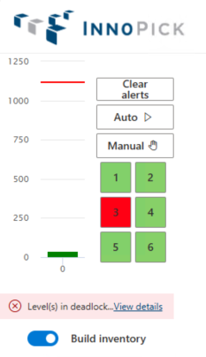
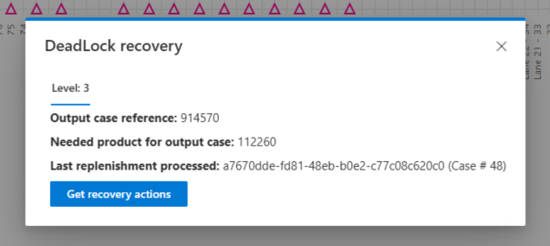
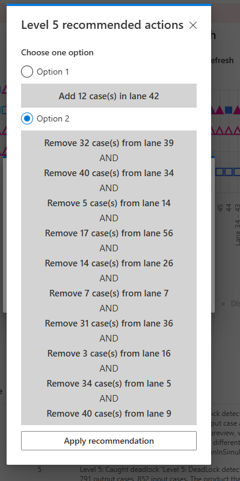
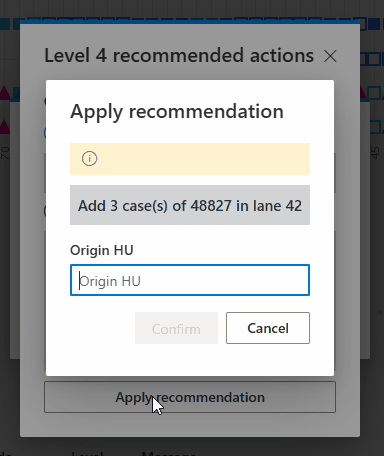
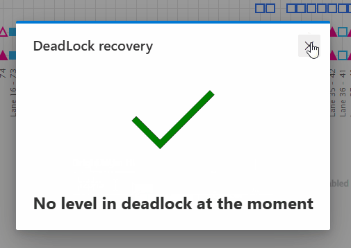
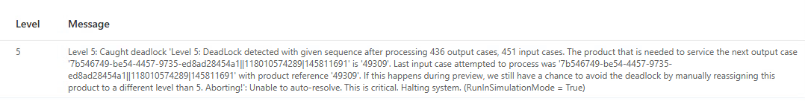
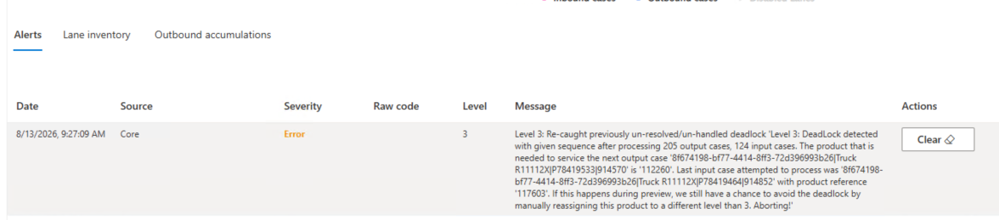

# Deadlocks

**[Home](../index.md) > [Troubleshooting](index.md) > Deadlocks**

## Overview

This section provides guidance for resolving deadlock situations.
A deadlock is when InnoPick is not able to fit all the cases that are due to enter the infeed, and it cannot make room by outputting cases because the next case needed for the sequence is coming after those cases which cannot fit.
In other words, a deadlock is when a level of InnoPick is too full and becomes stuck.

## Deadlocks Sub-Sections:
- [Types of Deadlocks](#types-of-deadlocks)
- [Detecting a Deadlock](#detecting-a-deadlock)
- [Recovering with Recommended Actions](#recovering-with-recommended-actions)
- [Preview Deadlock](#preview-deadlock)
- [Just-In-Time Deadlocks](#just-in-time-deadlocks)
- [Re-Caught and Unresolved Deadlocks](#re-caught-and-unresolved-deadlocks)

## Types of Deadlocks

There are three deadlock states:

1. **Preview deadlock (forecast)** - warns the operator that a deadlock will occur unless something is done to avert it.
2. **Just-in-Time deadlock** - the system is in a deadlock state and cannot proceed without an operator intervention.
3. **Re-caught deadlock** - a deadlock that was detected previously but never actually resolved, and has now been caught again.

## Detecting a Deadlock

When a level enters a deadlock, InnoPick signals it in two places in the left-hand panel:

- The tile for the affected level turns **red**.
- A red **Level(s) in deadlock... View details** indicator appears below the level tiles.

Click **View details** to open the DeadLock recovery dialog and begin [recovering with recommended actions](#recovering-with-recommended-actions).

## Recovering with Recommended Actions

InnoPick can calculate one or more ways out of a deadlock and then apply the fix for you. This is the fastest way to resolve a deadlock and should be your first approach.

### Step 1: Open the DeadLock recovery dialog

Click **View details** on the deadlock indicator.

The dialog reports, for the level in deadlock:

- **Output case reference** - the case InnoPick is trying to output but cannot.
- **Needed product for output case** - the product required to service that output case.
- **Last replenishment processed** - the most recent replenishment InnoPick handled on that level, with its case number.

If more than one level is in deadlock, each level appears as its own tab.

---

### Step 2: Get recovery actions

Click **Get recovery actions**. InnoPick calculates the possible ways to break the deadlock and presents them as a list of options to choose from.

Each option is a complete fix on its own. An option is either:

- **A single add** - for example, *Add 12 case(s) in lane 42*.
- **A chain of removals** - for example, *Remove 32 case(s) from lane 39* AND *Remove 40 case(s) from lane 34*, and so on. Every step in the chain must be completed for the option to work.

Select whichever option is simplest to carry out on the floor. A single add is often less work than a chain of removals spread across many lanes, but the best choice is whatever is physically easiest at the time.

---

### Step 3: Apply the recommendation

With your option selected, click **Apply recommendation**. A confirmation appears restating the action to be performed.

1. If the option **adds** cases, enter the **Origin HU** - the handling unit the cases are coming from. **Confirm** remains disabled until this field is filled in. Options that only **remove** cases do not ask for an Origin HU.
2. Click **Confirm** to apply the recommendation, or **Cancel** to go back and choose a different option.

**Note: Carry out the physical case moves described by the option. The recommendation tells InnoPick what the inventory should be; the cases still have to be added to or removed from the lanes on the floor.**

---

### Step 4: Verify the deadlock is cleared

On success, the dialog shows a green checkmark and **No level in deadlock at the moment**. The indicator in the left panel changes to a green **No deadLock**.

Return the level to Auto and confirm that production resumes.

If the level will not resume, or a deadlock is caught again on the same level, see [Re-Caught and Unresolved Deadlocks](#re-caught-and-unresolved-deadlocks).

## Preview Deadlock

A preview deadlock is a forecast. The system has determined that a deadlock will occur with the current case sequence, and has halted so that it can be averted before it happens.

*"Level 2. Deadlock detected with given sequence after processing 940 output cases, 850 input cases."*

The following is an example alarm message for a preview deadlock:

- *[Level 5] Level 5: Caught deadlock 'Level 5: DeadLock detected with given sequence after processing 111 output cases, 166 input cases. The product that is needed to service the next output case '0aa249a6-d163-4bb2-bfe9-9da964345d38|000000006500247839|119003120537|129563670' is '47692'. Last input case attempted to process was '0aa249a6-d163-4bb2-bfe9-9da964345d38|000000006500247839|119003120537|129563670' with product reference '47692'. If this happens during preview, we still have a chance to avoid the deadlock by manually reassigning this product to a different level than 5. Aborting!': Unable to auto-resolve. This is critical. Halting system. (RunInSimulationMode = True)*

---

### Key Points

- The deadlock is detected after processing a number of output and input cases
- This forecasts a future deadlock if nothing changes
- Manual reassignment of the key product to a different level can prevent it
- The system automatically enters manual mode to allow operator intervention

---

### Understanding the Causes of Preview Deadlocks

Preview deadlocks can be generated by one or more factors.

- There are too many products assigned to a single level of InnoPick, and the system has not found any way to avoid a deadlock situation.
- A replenishment has come in out of order (before the next priority replen), meaning it has to be stored completely in order for the priority replen can be brought in.
- The number of enabled buffer lanes was reduced since the initial case sequence calculation.
- A replenishment was shorted, but the shorted cases were needed to complete the case sequence. Now a new replen has been generated but the system has to store the active replens that are in the pipeline before it.

---

### Resolving a Preview Deadlock

- Note the product # and use the [Products Page](../main-screens/inventory-section.md#products-page) to re-assign it to another level.
- After this, the system will re-calculate the case sequence and may re-generate a preview deadlock fault depending on the context.
- Continue re-assigning the problematic product (as listed in the preview deadlock alert message) until no new preview deadlock alerts are generated.

## Just-In-Time Deadlocks

A Just-In-Time deadlock occurs when a level of InnoPick is full and cannot make even one move.
This can happen if:

- A preview deadlock is ignored / not resolved and the system is allowed to continue operating.
- Some unexpected change has occurred, and InnoPick can no longer continue on that level, such as the disabling of a lane that InnoPick was expecting to be able to use.

Example of a Just-in-Time deadlock alert message:

- *[Level 5] Warning: Just In Time deadlock detected on Level 5. The product that is needed to service the next output case '0aa249a6-d163-4bb2-bfe9-9da964345d38|000000006500247839|119003120537|129563670' is '47692'. Please fix manually!!!*

---

### Resolving a Just-In-Time Deadlock

Start with [Recovering with Recommended Actions](#recovering-with-recommended-actions). InnoPick will usually calculate a fix and apply it for you.

If no recommendation is offered, or none of the options can be carried out, resolve the deadlock manually using one of the two approaches below.

---

### Manual Recovery: Free Up Lanes

1. Identify some lanes on that level with low inventory (1-10 cases)
2. Makes sure those cases are not immediately going to be needed (using the [Case Sequence Page](../main-screens/case-sequence.md))
3. Empty those lanes, making them available.

---

### Manual Recovery: Supply the Needed Product

1. Identify which product InnoPick needs in order to resume outputting cases (this is listed in the Alert message, and in the DeadLock recovery dialog as **Needed product for output case**).
2. Filter the [Case Sequence Page](../main-screens/case-sequence.md) to see how many cases of this product are needed.
3. Manually load this number of cases of the required product in an empty lane on that level of InnoPick.
4. Edit the inventory for that lane and save the changes, using the [Inventory Page](../main-screens/inventory-section.md#alter-quantity).
5. Upon saving the changes to the inventory change, the system should recalculate the case sequence for that level and production should resume.
6. If needed, use the "Reprocess level" [Recovery Action](../main-screens/administration/recovery-actions.md).

## Re-Caught and Unresolved Deadlocks

If a deadlock is cleared from the Alerts page but the underlying condition was never actually fixed, InnoPick will catch it again and report it as a re-caught deadlock.

Example of a re-caught deadlock alert message:

- *Level 3: Re-caught previously un-resolved/un-handled deadlock 'Level 3: DeadLock detected with given sequence after processing 205 output cases, 124 input cases. The product that is needed to service the next output case '8f674198-bf77-4414-8ff3-72d396993b26|Truck R11112X|P78419533|914570' is '112260'. Last input case attempted to process was '8f674198-bf77-4414-8ff3-72d396993b26|Truck R11112X|P78419464|914852' with product reference '117603'. If this happens during preview, we still have a chance to avoid the deadlock by manually reassigning this product to a different level than 3. Aborting!'*

**Note: Clearing a deadlock alert does not resolve the deadlock. The inventory on the level has to actually change - either by applying a recommended action or by recovering manually - before the level can resume production.**

If you see a re-caught deadlock, treat it as an unresolved Just-In-Time deadlock and work through [Recovering with Recommended Actions](#recovering-with-recommended-actions) again. If it keeps recurring on the same level, contact remote support.

## Related Topics

- [Alert Guidelines](alert-guidelines.md) - General troubleshooting principles
- [Alert Reference](alert-reference.md) - Specific alert code resolutions
- [Common Issues](common-issues.md) - Other frequently encountered problems
- [Case Sequence Page](../main-screens/case-sequence.md) - Checking which cases are needed next
- [Products Page](../main-screens/inventory-section.md#products-page) - Re-assigning products between levels
- [Recovery Actions](../main-screens/administration/recovery-actions.md) - Reprocess level and other advanced tools

